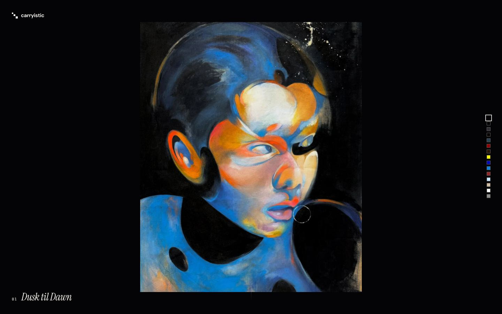

# Carryistic

[Open the portfolio](https://carryistic.vercel.app/) · [Offline screening kit](https://drive.google.com/drive/folders/1qjbQmd1ob6WyTthBDtWGXcai26FL3Zgz) · [Google Drive reference library](https://drive.google.com/drive/folders/1fbso1aN0VT27E0wNxjwqrTS4eapcjhkn)

[](https://carryistic.vercel.app/)

The portfolio is one continuous scroll through Carry’s 15 posts, and the scroll is the film.

- **The entrance** is *Dusk til Dawn*, whole, on black. Scrolling moves into the painted eye, peels the oil back to its pencil line and the photograph it came from, then steps back to the canvas on the wall.
- **The order follows the light** in her pictures: nights with friends, candlelit gold, a neon record store, daylight on the waterfront in *Fly*, travel, and finally the studio. It ends on Carry beside *Proud Daddy*.
- **One colour runs through the page.** Each work’s ground is sampled from one of her slides. Each handoff is a different move taken from her own pictures, and no move repeats back to back. The BLACKOUT triptych drops in as three panels. The halo irises open on the sculpture’s gold rim. The sculpture spins away like a record. Her red starburst opens onto the sky in *Fly*. [Watch the walkthrough](direction/scroll-walkthrough.mp4) · [Direction, storyboard and the twelve moves](direction/scroll-direction.md)

Every one of the 153 published positions appears large in its room and again in a strip of that post. Click any slide to open it with its credit, Instagram post and original file, then use the arrow keys to move through all 153. Each position has its own link, such as `#work-P07-11`. Credits, the first film (*Afterimage*), and a notebook for Carry wait quietly at the end. [Originals](archive/artworks) · [36-page atlas](archive/Reference%20atlas.pdf) · [Slide index](archive/Image%20index.csv)

## Reviewing with Carry

Let Carry scroll at her own pace. **Leave a note** at the end turns her words into a link she can send to whoever she chooses, or a JSON file she can save. Opening the link restores her words. Links in the earlier `#response=` format still open. A draft stays in the current browser. The portfolio collects no microphone, camera or analytics data.

## Generated passages

The Higgsfield requests are rendered natively in 4K:

- seven bridges and living stills, each starting and landing on Carry’s own frames;
- three rendered versions of the code-built moves;
- five experiments: her footage upscaled to 4K, the sculpture in 3D, a score that follows the light, and the recurring circle as one 4K HDR shot.

Until Astra delivers a clip and marks it ready in `src/motion.json`, the code-built move plays, so the site never waits on generation. [Requests, frames and encoding](direction/astra-requests.md) · [Earlier Seedance bead test](film/experiments)

## Working with Opus

Opus started from the unannotated contact sheets and saved an independent reading before reading the director’s record. That reading led to the colour-handoff direction this scroll is built on. It also found P07-11, the faint ghost of the child on raw linen, which the scroll now uses as its last image before Carry. [Independent first look](direction/opus-independent.md) · [Director’s record](direction/director-record.md) · [Collaboration research](direction/collaboration.md)

## Edit or screen the work

Use Node 22.12 or newer.

```sh
npm ci
npm run dev
npm test
npm run build
```

The rooms are written in `src/rooms.js`, one beat per move, with durations in screen heights. The engine is `src/scroll.js`. `scripts/prepare-scroll.py` rebuilds the sharp stills, strip thumbnails, reel and orbit flipbooks, and Astra’s request frames from `archive/artworks`. It needs Python 3 with Pillow, and FFmpeg.

The Vercel project `carryistic` builds the `main` branch with Vite and serves `dist/`. A GitHub Pages edition remains at its previous address. [Vercel portfolio](https://carryistic.vercel.app/) · [GitHub Pages](https://bobshenruililin.github.io/Carryistic/)

`dist/Carryistic.html` is the single-file edition, at 41.6 MB. Every still in the scroll and the viewer is embedded, as are the reel and orbit frames, fonts and the first film. The three full-length source movies and the full-resolution files open online. [Download the HTML](https://github.com/bobshenruililin/Carryistic/raw/refs/heads/main/handoff/Carryistic.html) · [Film and timecodes](film) · [Rhythm reference](direction/rhythm.md)
