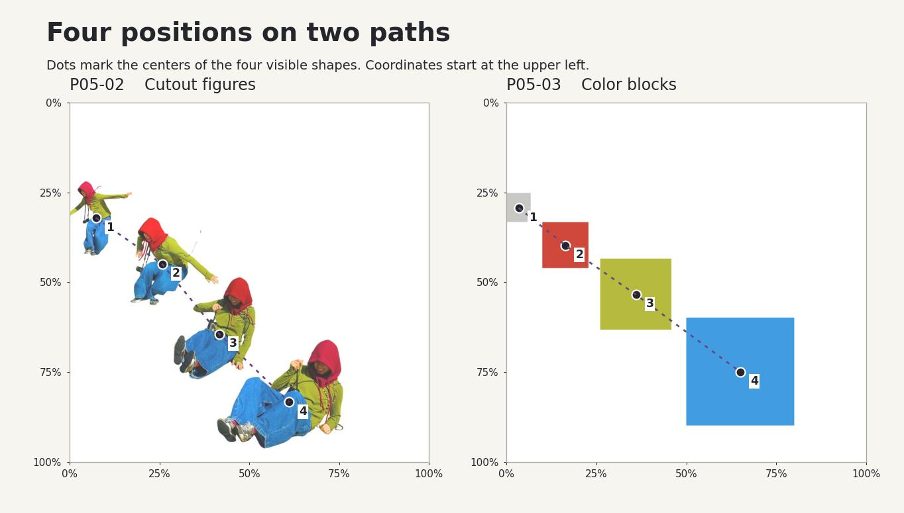
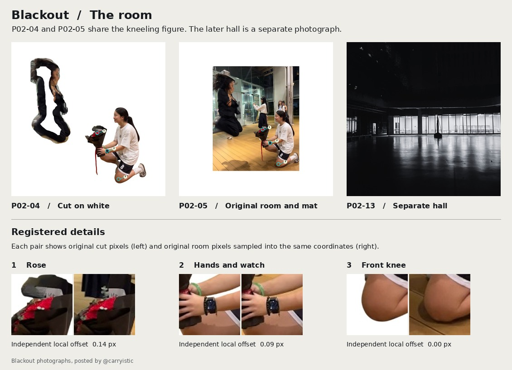

# What survives the cut?

In *Fly*, the horizon disappears first. Four red hoods still fall across white. On the next slide, even the hoods disappear. Four blocks of increasing size carry the landing. My prediction for this portfolio is that a viewer can follow a dream through quite large changes of material if one gesture survives each cut. Carry gets to say whether that reading feels like hers. [The three published frames](../archive/artworks/P05%20-%20Fly)

## What the archive supports

The archive has 150 image slides and three video positions across 15 posts. Each post contributes at most one count to each row below. A 14-slide design study and a single reel therefore carry equal weight. The matrix records the slide IDs behind each positive, a counterexample or detail for each post, and one uncertain call. Empty cells mean the post did not meet that particular definition on review. [Per-post evidence](post-evidence.csv) · [All 153 positions](../archive/Image%20index.csv)

| Visible choice | Criterion used | Posts of 15 | Example |
| --- | --- | ---: | --- |
| Inset on a flat field | An edited rectangle containing a photograph or drawing has a deliberately flat surround visible along at least three sides. | 10 | Two faces occupy opposite corners of pink in P04-05. A lone aisle photograph sits in yellow in P09-13. |
| Isolated figure | A photographic body is cut away from its surroundings and placed on a graphic field, or repeated as a color silhouette. | 6 | The same kneeling figure holds the bouquet in P02-04 and P02-05. Compare her outline against white and against the room. |
| Studio process | Tools, the working surface or an unfinished stage are visible during the making of a drawing, painting or object. | 3 | The projected contour and artist’s arm in P01-06, the unfinished basketball portrait in P07-05, the light table in P12-07. |
| Photograph and oil | A reference photo and its finished oil painting occupy separate slides in the same post and share at least two identifiable landmarks. | 2 | Eye and jaw in P01-09 / P01-02. Ball, fingers and chair in P07-04 / P07-01. |

Three grid entries carry another posting handle, @20.09.07.29 or @bigartparty. Restricting the count to the 12 posted by @carryistic gives **9, 6, 2 and 2**, respectively. P14-01 remains uncertain for figure isolation because the pale wall and horizontal bands obscure where the cutout would end. These categories overlap. The counts describe compositional choices in this archive. Carry’s taste, her reasons for publishing and anyone’s neural responses require different evidence.

## One measurement that changes the 3D direction

In both square images, every step moves right, moves down and increases in visible area. The line joining the first and fourth centers runs **43.7° down from horizontal** for the figures and **36.5°** for the blocks. The fourth figure occupies **4.62 times** the first figure’s visible pixels. The fourth block occupies **16.47 times** the first block’s. Both first forms meet the left edge of the frame.

That difference gives the animator permission to change scale aggressively. Preserve the order and growing weight. Let the positions shift as Carry shifted them. To check the measurement, take each 1280 × 1280 JPEG, mark pixels whose lowest RGB channel is below 240, then sort the four largest four-connected components from left to right. The center is the mean of their pixel coordinates. The counts measure the shapes visible inside the frame. [Reproduce the measurements](measure_fly.py) · [Cutout plate](../archive/artworks/P05%20-%20Fly/P05-02.jpg) · [Block plate](../archive/artworks/P05%20-%20Fly/P05-03.jpg)

## A room held together by a bouquet

In *Blackout*, the hollow upper-left figure and the person holding the bouquet in P02-04 return to their places in P02-05. Reducing the cutout to about 75% and translating it by roughly 135 pixels on each axis registers the rose, watch and knee on the 1080-pixel photograph. The hollow falls on the other person in the room. The setting is already there in the relationship between the two slides. [Original plates](../archive/artworks/P02%20-%20Blackout%20photographs) · [Measured registration](../src/blackout-registration.json)

Our prediction is that holding the bouquet steady makes the shift from a gesture to a social scene legible. In *The room*, the first glimpse of color comes through Carry’s cut shape. The paper moves aside. Three strips of the photograph then open on the empty hall of P02-13, taking their spacing from the vertical gutters in the P02-01 triptych. That last move joins two separate photographs. Whether the hall feels like relief, an absence, or somewhere else entirely is a question for Carry.

## Where the reading could break

- **The fall may remain legible in depth.** Start four image planes at the measured projected positions. Move the camera sideways just far enough for the spaces between them to open. In a private comparison, hold crop, duration and sound constant and play a second take with a fixed camera. Ask what action the viewer remembers. If the movement of the camera buries the landing, shorten its travel.
- **One change of material may carry a cut.** The records in P11-01, gold-rimmed opening in P08-04 and ball in P07-01 give the editor three different surfaces with round edges. A proposed AI insert could move a narrow reflection along a bead and let it disappear at the paint edge. Supply the original frames at both ends, use masks to hold the hands and the ball still, and compare the insert with a straight cut of the same duration. If a viewer loses the connection to the painted hands, retain the straight cut. This is an editorial invention.
- **A quiet room may be the strongest ending.** P02-13 holds an almost empty hall. P13-06 holds a flame against black. P07-02 reveals the canvas at the scale of the person holding it. These give Carry room to contradict an all-motion reading. In a private timing test, try a longer hold on the studio wide and ask what detail stays with the viewer.

These comparisons are internal to the edit. Reverse their order on a second viewing if one version always plays first. Show the audience one directed experience. An open invitation for Carry could be “What stayed with you, and what part of the work would you give more room?” Her own language can change the treatment.

## What two portfolio visitors need

**An admissions reader** can ask how observation develops into an independent decision. Follow the photographic glance into pencil, oil and the projected outline. Show the fingers on the ball, the unpainted canvas and one final wide studio view. Those sequences reveal choice, revision and scale. [Dusk til Dawn](../archive/artworks/P01%20-%20Dusk%20til%20Dawn) · [Proud Daddy](../archive/artworks/P07%20-%20Proud%20Daddy)

**A commissioning client** can ask which decisions Carry owned and which can translate into another format. Match the held cap in P11-04 to the repeated silhouettes in P10-01. That pair can anchor a conversation about turning a photographic shoot into a poster or motion sequence. The P10 caption credits @bigartparty for photography. P11 was posted by @bigartparty and credits @ca.m.z for help taking the photographs. P09 credits @bigartparty as model. P08 and P12 were posted by @20.09.07.29. Keep museum artworks shown in travel collages identified as contextual material. [Record-store shoot](../archive/artworks/P11%20-%20Record-store%20shoot) · [Record-store portraits](../archive/artworks/P10%20-%20Record-store%20portraits)

The director supplied Stephen Curry as an inspiration. The archive gives us a source photograph, the painted basketball, and a person beside the canvas in a number 30 jersey. The pictured child’s identity and the personal meaning of the jersey are questions for Carry. Treat “Welcome to my dream” as proposed language. Ask what words she would put on the entrance. [Jersey and canvas](../archive/artworks/P07%20-%20Proud%20Daddy/P07-10.jpg) · [Direction handoff](opus-handoff.md)
