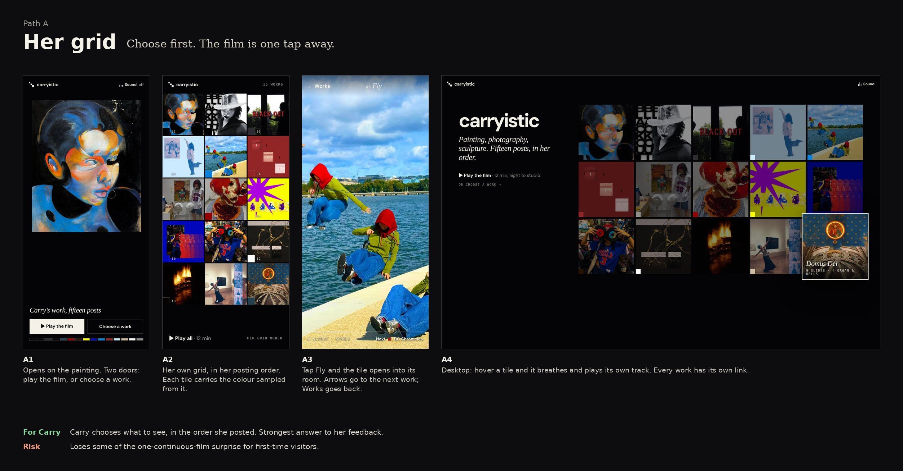
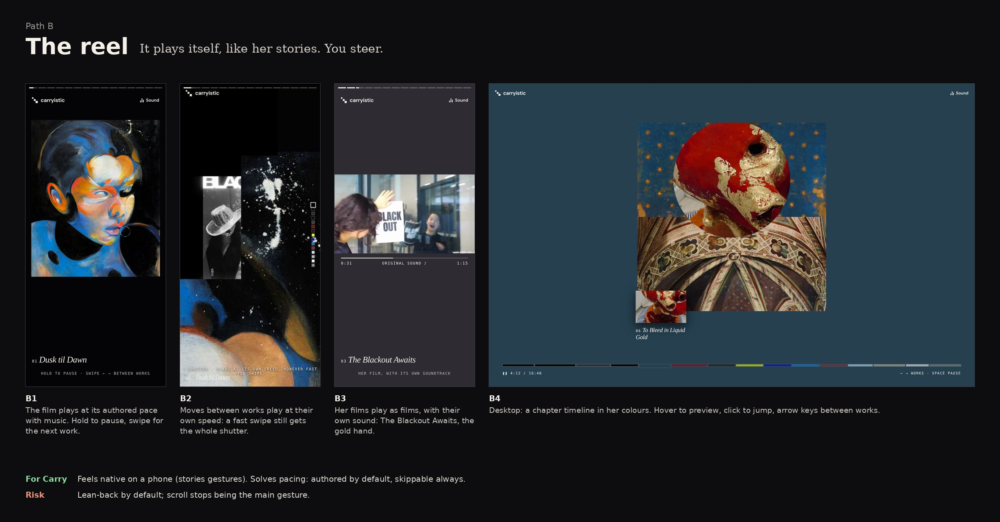
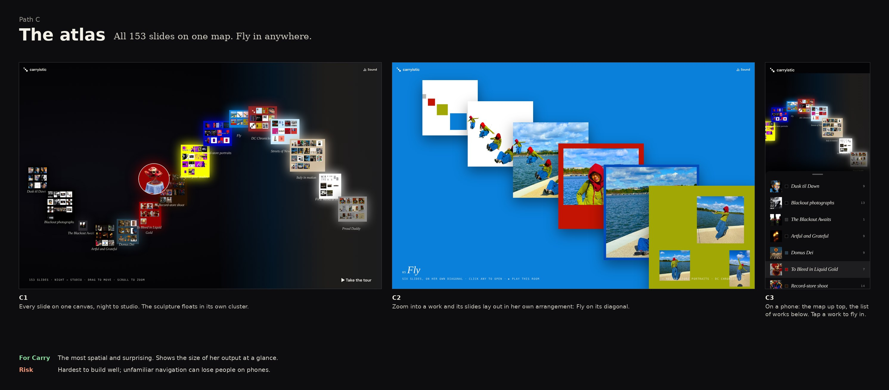
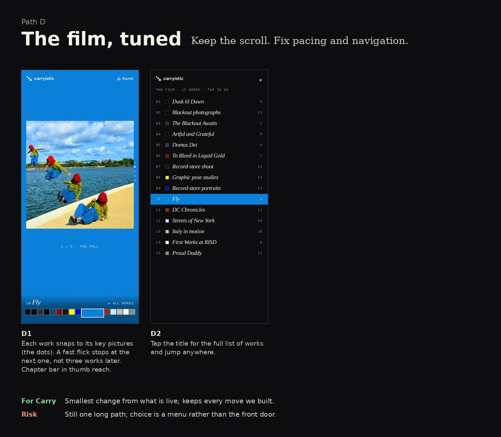

# Where the scroll goes next

The first draft is live. This note answers three pieces of feedback with four possible paths, mock-ups made from Carry’s own images, and one exploratory effect. It is a plan to choose from, not a build.

## What we heard

- **Carry:** “there’s so many steps to go through. and i cannot choose what i wanna go through”
- **A designer:**
  - It’s hard to reach the exact part you want.
  - It’s hard to scroll on a phone.
  - A lot of the footage isn’t in the site.
- **The director:**
  - Things go by too quickly.
  - But some visitors just want to skim.
  - Make it crazier, more dynamic and more 3D.
  - Give each work its own music.

These are fair. The live scroll is one 74-screen path. On a phone that’s roughly 74 flicks to reach *Proud Daddy*. The only shortcut is a column of 9-pixel squares.

## Pacing: two clocks

Fast skimmers and slow viewers need different things from the same gesture. Every path below uses this model:

1. **Inside a work, the scroll drives the picture,** but it snaps to that work’s key pictures. A fast flick stops at the next picture instead of flying through three works. Each work shows its stops as dots.
2. **Between works, the move plays at its own designed speed** once you cross the line. Shutters, iris, spin and flip take about 1.2 s whether you crawl or fling, so a skimmer gets a crisp cut instead of a smear.
3. **Watch mode.** The whole film can also play by itself at its authored pace, with music. Hold to pause, swipe to change work.

## Four paths

### A · Her grid: choose first, the film is one tap away

- **The entrance:** the painting opens with two doors, “Play the film” and “Choose a work”.
- **Her grid:** the works appear in **her own posting order**, the order her fans know from Instagram. Each tile carries its sampled colour.
- **Rooms:** a tile opens into its room through her window move. Each room is short, has its own link and its own track, and offers next and back.
- **Desktop:** hovering a tile makes it breathe and play its music.

### B · The reel: it plays itself like her stories, and you steer

- **Phone:** stories-style progress bars in her colours. Hold to pause, swipe for the next work.
- **Her films play as films,** with their own sound: *The Blackout Awaits* and the gold hand.
- **Desktop:** a chapter timeline. Hover to preview, click to jump, use the arrow keys between works.

### C · The atlas: all 153 slides on one map

- **The map:** every slide sits on one canvas, from night to studio, with the sculpture turning in its cluster.
- **Zooming in:** each work lays its slides out in her own arrangement. *Fly* sits on its diagonal.
- **The tour:** “Take the tour” flies the camera through the clusters.
- **Phones:** the map on top, a list of works below.

### D · The film, tuned: keep the scroll, fix pacing and navigation

- **Snap stops** inside each work.
- **A thumb-height chapter bar** at the bottom of the screen.
- **The title opens a list of all fifteen works.**

## Recommendation: A as the front door, with D and B inside it

Carry asked to choose, so choice should be the front door, not a menu. Her grid is her own curation, so starting there honours how she already presents her work. Behind the “Play the film” door:

- **The film is D’s tuned scroll:** snap stops, moves on their own clock, and the chapter bar.
- **There’s a watch toggle (B)** for anyone who would rather lean back.
- **Every room is reachable in one tap** and has its own link.
- **A visitor can enter the film at any work** and keep going from there.

The atlas (C) is the boldest idea. It could arrive later as a desktop-only “see everything” view once the core is right.

## Making it crazier, in her own language

- **Her effects become the transitions.** Halftone (P09-05), pixelation (“What should CARRY do?”, P11-10), RGB split (P09-10), duotone (P09, P10) and echo (P10-01) can each become a GPU transition between her own pictures. They are drawn from techniques she already uses, so they look like her rather than like a plugin.
- **Her cutouts become real depth.** Her own *Fly* cutouts (P05-02) register exactly on the waterfront (P05-01): the best alignment is zero offset, with near-identical colour. Moved apart by a finger, or by tilting a phone, the bodies lift off the photograph. A faint echo trails behind them, which is her own device. [Watch the test](paths/fly-parallax.mp4)

  The same works anywhere she cut a figure out: the kneeling figure with the bouquet (P02-04 over P02-05) and the raised arm in New York (P04-02).
- **Every room gets a living hero.** More 4K living stills, with her figures held pixel for pixel, as in *Fly*.
- **The sculpture can come to your table.** A phone can place it in augmented reality.

  A real capture would be better still. If Carry still has the piece, a one- to two-minute walk-around video becomes a photographic 3D capture (a Gaussian splat) with no invented geometry.

## Music for each work

Each of the fifteen works gets its own instrumental track of 60–90 s. Each of the twelve moves gets a short sound, so the transitions feel physical. Astra can generate these with ElevenLabs Music through Higgsfield. The tracks share a key family so neighbours crossfade cleanly.

| Work | Track | Move into the next work, and its sound |
| --- | --- | --- |
| *Dusk til Dawn* | Warm synth bloom and felt piano, night air | Shutters: heavy flats landing |
| *Blackout photographs* | A house beat heard through a wall, mirror-ball shimmer | Window: a rush of air |
| *The Blackout Awaits* | **Her film’s own soundtrack.** Nothing generated. | Fade: silence |
| *Artful and Grateful* | Fire crackle, acoustic guitar, a party far away with no words | Rise: a breath of flame |
| *Domus Dei* | Organ pad, distant bells, stone reverb | Iris: a struck glass ring |
| *To Bleed in Liquid Gold* | Glass beads, metallic taps, a slow sub-bass heartbeat | Spin: a record spinning down |
| *Record-store shoot* | Vinyl crackle, boom-bap, chopped soul | Flash: a camera pop and recharge |
| *Graphic pose studies* | Glitchy synth-pop arpeggios | Template crossfade: a tape stop |
| *Record-store portraits* | Lo-fi tape echo, one motif repeating like her echoes | Starburst: a bright zap |
| *Fly* | Airy guitar and wind, rising | Flood: paint pouring |
| *DC Chronicles* | Museum hush, brushed jazz | Flip: a card turning |
| *Streets of New York* | Street pulse, subway hum, upright bass | Slices: strips pulling |
| *Italy in motion* | Mandolin and strings, a warm afternoon | Drain: a low hum fading |
| *First Weeks at RISD* | Pencil scratches as rhythm, solo piano | Unfold: paper opening |
| *Proud Daddy* | Warm piano with a basketball bounce as the kick | End |

Sound stays off until a visitor asks for it. In the grid, hovering a tile previews its track.

## Footage to bring in

- ***The Blackout Awaits*** plays as real video with its original sound, from Astra’s 4K master, when sound is on. The flipbook stays for silent scrolling.
- **The gold hand** (P08-07) plays as a loop in *To Bleed in Liquid Gold*.
- **Astra’s 4K upscales** of the sculpture orbit and the gold hand replace the 720 px versions.
- **The two circle passages** (halo → rim → record → basketball, 4K HDR) can be the trailer behind “Play the film”.
- ***Afterimage***, the first film, moves from the end card into the grid as its own tile.

## Before building

Pick a path, or a mix. Then show Carry the grid board (A2) and ask the one question that decides the front door: **in the grid, which order does she want: her posting order, or the night-to-day order of the film?**
