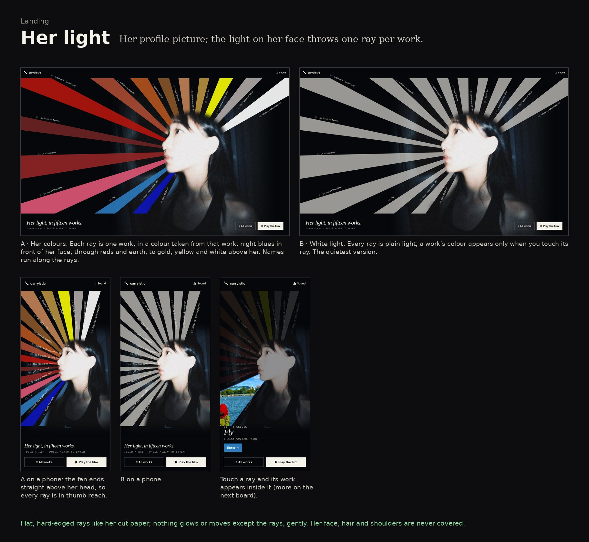
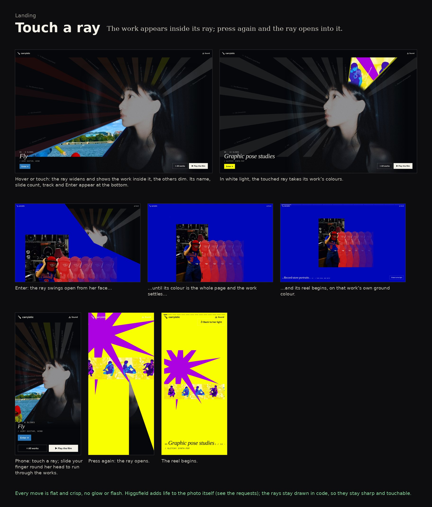
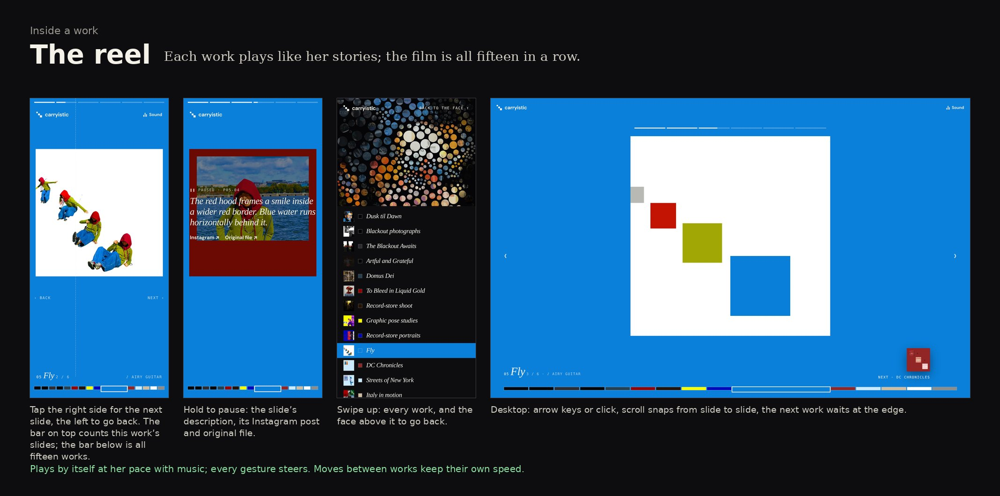

# Her light, the reel, the film

Plan v2. The director chose path A as the front door, the reel for choosing a work, and the best parts of D. The landing is now Carry’s profile picture, with the light on her face throwing one ray per work. Everything here was tried on her real images first. [Four paths](next-paths.md) · [Prototype](../lab/rays/index.html)

## The shape of the site

```
            ┌────────────── Her light ─────────────┐
            │ her profile picture; fifteen rays    │
            │ from the light on her face, one per  │
            │ work                                 │
            └──┬────────────────┬────────────────┬─┘
      touch a ray       ▶ Play the film     ≡ All works
            │                   │                │
   the ray opens into     all fifteen in    list of works
      that work           light order
            └───────► The reel ◄─────────────────┘
          each work plays like her stories;
          swipe for the next work, up for all works,
          down to return to her light
```

## 1 · Her light (landing)





[Try it](paths/rays-prototype.html): one file with everything inside, so it opens on a phone. Clips: [desktop](paths/rays-desktop.mp4) · [phone](paths/rays-phone.mp4) · [white light](paths/rays-white.mp4)

- **What it is.** Her profile picture, untouched, and fifteen flat rays coming out of the light on her face into the dark she is looking at. Each ray is one work.
  - It answers her feedback: all fifteen works, named, on the first screen, one touch from each.
  - It follows her own way of working: flat colour, hard edges, a cut-out against a ground, a lot of empty space, little type. There is no glow, dust or gradient. The starburst is already hers (P09-01).
- **Colours,** taken from each work, not invented. They run round her head from night to day: blues low in front of her face, through reds and earth, to gold, yellow and white above.

  | Ray | Work | Colour from |
  | --- | --- | --- |
  | 01 | Dusk til Dawn | the painted blue |
  | 10 | Record-store portraits | the ultramarine ground |
  | 05 | Fly | the water |
  | 04 | Streets of New York | the pink |
  | 06 | DC Chronicles | the maroon ground |
  | 03 | The Blackout Awaits | the red of its title |
  | 08 | To Bleed in Liquid Gold | the red of the sculpture |
  | 13 | Artful and Grateful | the fire |
  | 14 | Italy in motion | the terracotta |
  | 07 | Proud Daddy | the brown armchair |
  | 11 | Record-store shoot | the lamp-lit wood |
  | 15 | Domus Dei | the gold mosaic |
  | 09 | Graphic pose studies | the yellow ground |
  | 12 | First Weeks at RISD | the graphite |
  | 02 | Blackout photographs | the white of the prints |

  A work with more slides throws a slightly wider ray. **White light** is the quieter alternative: every ray is plain light until touched, and then it takes its work’s colours.
- **Touch.**

  | Device | Gesture | Result |
  | --- | --- | --- |
  | Desktop | Hover | The ray widens, the work appears inside it and the rest dims |
  | Desktop | Click | Enter |
  | Phone | Touch | The ray widens and the work appears inside it |
  | Phone | Slide a finger round her head | Runs through the works |
  | Phone | Press again | Enter |
  | Keyboard | Arrow keys, Enter | The same |

  The name, the number of slides, the track and *Enter* sit at the bottom, away from her face.
- **Entering.** The chosen ray swings open from her face until its colour is the whole page. The work settles onto that colour, which is its own ground in the film, and its reel begins. The move is flat and crisp, with no flash, and runs on its own 1 s clock.
- **Her figure.** The rays never cover her face, hair or shoulders.
  - **Her profile** is cut by the light on her face itself (`carry-light-mask.png`). It is the brightest thing in the picture, so the edge where the rays meet her nose and lips is the photograph’s own.
  - **Her hair and shoulders** follow a rough hand-drawn outline, blurred wide so no traced edge shows: [`carry-outline.json`](../archive/profile/carry-outline.json).
  - **Adjusting it.** Anyone can move the outline’s points, then run `python scripts/prepare-profile-masks.py --check out.png`.
- **Higgsfield.** The photograph comes alive slightly (L1) and the light switches on at the start (L2); see the requests below. The rays stay in code, so they stay sharp and touchable.

### Dropped: the face in circles

The face built from circles of all 153 slides ([earlier board](paths/v2-face.jpg)) is dropped. The dense clusters of circles were uncomfortable to look at, and her profile picture is too dark and soft to hold a face made that way. The generator stays in [`scripts/prepare-collage.py`](../scripts/prepare-collage.py).

## 2 · Into a work: the ray opens

The chosen ray swings open from her face until its colour fills the page. The work settles onto it and the reel begins (third row of [Touch a ray](paths/rays-touch.jpg)). The move is flat, crisp and code-built, so it plays the same on every device and needs no generated clip.

**Kept as an alternative:** the pixel break, her move from “What should CARRY do?” (P11-10). The landing breaks into blocks that fly out from the finger and land as the work. [Board](paths/v2-into-a-work.jpg) · [Clip](paths/landing-into-fly.mp4)

## 3 · Inside a work: the reel



- **Beats** are her slides plus the moves already built for that work: the peel in *Dusk til Dawn*, the bouquet registration, the drag-to-turn orbit, the sculpture.
- **It plays by itself** at her pace with that work’s music. A slide holds about 3 s; key pictures hold about 5 s.
- **Phone:**

  | Gesture | Result |
  | --- | --- |
  | Tap right | Next |
  | Tap left | Back |
  | Hold | Pause, with the slide’s description, Instagram post and original file |
  | Swipe sideways | Next or previous work |
  | Swipe up | All works |
  | Swipe down | Back to the face |

- **Desktop:** arrow keys and clicks. One wheel notch moves one beat, so the page snaps instead of streaming.
- **Two bars:**
  - **On top:** this work’s slides.
  - **At the bottom:** all fifteen works in their colours, with the current one wide (from D).
- **Moves keep their own clock.** Swiping to the next work plays its exit move (shutters, iris, spin, flip and the rest) in about 1.2 s, however fast the swipe. Skimmers get a sharp cut; lingerers get the whole move.
- ***Play the film*** is the same reel run through all fifteen works in light order, night to studio. It takes about 12–14 minutes, and the music crossfades from work to work.
- **Every work has its own link,** so the designer’s problem of reaching an exact part goes away.

## How the engine carries over

- **Rooms become reels.** The beats and keyframes in `src/rooms.js` stay as they are. A clock drives them instead of the scroll position, and gestures move a target the clock eases towards. Each beat gets a hold point, which is where the snap stops.
- **Exits stay the same.** They now fire on a change of work and run on their own timer.
- **Media stays as built:** the viewer, the sculpture, the drag-to-turn orbit, the clips and the music module.
- **Mobile performance:** only the current work and its neighbours load, as today.

## The dynamic ideas, placed

| Idea | Where | Built from | Status |
| --- | --- | --- | --- |
| Her light: fifteen rays from the light on her face | Landing | Her profile picture, a colour from each work | Prototype |
| The ray opens into its work | Landing → reel | Flat colour, her grounds | Prototype |
| A living photograph and the light switching on | Landing | Higgsfield 4K, her profile held | Astra (L1, L2) |
| Pixel break into a work | Landing → reel, alternative | Her pixelation (P11-10) | Prototype clip |
| Her effects as transitions between slides | Inside reels | Halftone in P09, pixelation in P11, RGB split (P09-10), duotone in P10, echo (P10-01) | To build in WebGL |
| Depth from her own cutouts, by tilt or finger | *Fly*, *Blackout*, New York | P05-02 over P05-01 (zero-offset registration), P02-04 over P02-05, P04-02 | Tested |
| Living first slide in each work | Every reel | Higgsfield 4K, her figures held | Astra |
| Sculpture to turn, and place on a table | *To Bleed in Liquid Gold* | Live 3D model, plus augmented reality on phones | Live; AR to build |
| A real 3D capture of the sculpture | *To Bleed in Liquid Gold* | A walk-around video from Carry | Needs the video |
| A track per work, a sound per move | Everywhere | ElevenLabs Music through Higgsfield | Astra |

## Generation requests for Astra

This session can read Higgsfield but not generate, so these go to Astra. Everything is native 4K or full-quality audio and silent unless stated, with the same contract as before: deliver, mark ready, test, ledger. [First handoff](astra-requests.md)

**1 · Fifteen tracks.** Instrumental, 75 s, with loopable ends. Keep a D-centred key family so neighbours crossfade, as the first five cues did.

| Work | Prompt |
| --- | --- |
| Dusk til Dawn | Slow warm synth bloom, felt piano, night air, 72 BPM |
| Blackout photographs | A house beat heard through a wall, mirror-ball shimmer, muffled crowd without words |
| The Blackout Awaits | None: her film’s own soundtrack, from Astra’s 4K master |
| Artful and Grateful | Fire crackle, warm acoustic guitar, distant friends without words |
| Domus Dei | Organ pad, distant bells, stone reverb |
| To Bleed in Liquid Gold | Glass beads and metallic taps over a slow sub-bass heartbeat |
| Record-store shoot | Vinyl crackle, boom-bap drums, chopped soul feel |
| Graphic pose studies | Glitchy synth-pop arpeggios, bright and playful |
| Record-store portraits | Lo-fi tape echo; one short motif repeating like her echoes |
| Fly | Airy guitar, wind, a rising figure |
| DC Chronicles | Museum hush, brushed jazz trio |
| Streets of New York | Street pulse, subway hum, upright bass |
| Italy in motion | Mandolin and strings on a warm afternoon |
| First Weeks at RISD | Pencil scratches as rhythm, solo piano |
| Proud Daddy | Warm piano with a basketball bounce as the kick; quiet pride |

**2 · Thirteen move sounds.** One to two seconds each:

- shutters landing
- a rush of air (window)
- a breath of flame (rise)
- a struck glass ring (iris)
- a record spinning down (spin)
- a camera flash and recharge (flash)
- a tape stop (template)
- a bright zap (starburst)
- paint pouring (flood)
- a card turning (flip)
- strips pulling (slices)
- a low hum fading (drain)
- paper unfolding (unfold)

**3 · The landing: her photograph, alive** (Seedance 2.5, 4K, 1:1; full prompts in [`requests.json`](../film/requests/requests.json)):

| Shot | Start → end | Motion | Protect | Discard if |
| --- | --- | --- | --- | --- |
| **L1** · 6 s loop | Her photograph → the same frame | A few strands of hair stir; the light on her face breathes slightly; the camera never moves | Her profile pixel for pixel, because the rays meet it in code; her eyes and mouth | Her profile or features move more than 2 px at 1080, she blinks or her mouth moves, or the ends differ |
| **L2** · 3 s | The photograph at 6 % brightness → the photograph | A handheld light switches on from the left, where she looks, and finds her face; then the rays grow in code | The final frame exactly; her profile throughout | Her face or pose changes, the light comes from the right, or the last frame differs |

The fifteen entry clips planned for the circle face are withdrawn: the ray opening is flat and code-built.

**4 · Fifteen living first slides.** 4K, 5 s, with her figures and faces held pixel for pixel (Astra’s `lock-fly-motion.py` method). Only light, water, sky, smoke or fabric moves.

## Build order

1. **The core.**
   - Her light: the rays, the touch, and the ray opening into a work.
   - The reel engine: clock, gestures, the two bars, *All works*.
   - Film mode.
   - Per-work links.
   - Tests, then deploy.
2. **Sound and motion.** Tracks and move sounds, the living photograph (L1, L2) and living slides as Astra delivers them.
3. **Her effects.** The transition shaders, cutout depth with tilt, and augmented reality for the sculpture.
4. **Carry’s review,** then a real 3D capture if she can film the sculpture.

## For Carry

The director likes the light but isn’t sure the rays are her style, so the landing goes to her as questions first. Each answer changes what gets built.

1. **How would light come off this photo in your style?**
   - Hard straight rays (as in the prototype, or her P09 starburst).
   - Cut-paper strips.
   - The photo split into bands of colour.
   - A single flat colour behind her.
   - Something else.
2. **Your photo as it is, or you cut out onto a flat ground,** the way the figures sit in *Fly* and *Streets of New York*? A cut-out needs a clean edge; the director can draw it.
3. **Colour:** every work in its own colour, white light until touched, or one colour for all?
4. **Names along the rays, or nothing until touched?**
5. **The list of works.** Her posting order, or the film’s night-to-day order?
6. **The linen.** Should the faint child on raw linen (P07-11) close *Proud Daddy*?
7. **The sculpture.** Is she happy showing a 3D reconstruction of it, and could she film a walk-around of the real piece?
