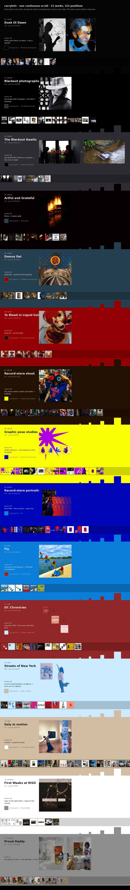

# One ground, handed on

A direction for turning the portfolio into one continuous scroll through all 15 works. Opus wrote it after the [independent first look](opus-independent.md) and then the director’s record, the film, the live site and the reference reels. It is a proposal to discuss, not a build.

## The problem with the current site

Each piece of the current build is good on its own, but it reads as separate stations:

- a film behind a button;
- three studies, each with a slider and a play button;
- a scrub strip;
- an index;
- a notebook.

Each station has its own background, heading and controls. Only five of the 15 posts appear before the index, so a visitor who just scrolls never meets most of Carry’s work.

## The idea: take Carry’s own layout rule and make it the page

Carry already has a system for moving between images. **She takes a color out of a photograph and makes it the ground.**

- P05-03 is literally a swatch card of *Fly*: grey, red, olive and blue taken from the picture. P05-04 to 06 then frame the photos in those colors.
- She reuses her own templates. P09-01 and P10-08 are the same layout, a starburst over a horizontal strip of poses, in different color pairs. P06-02 and P04-02 share the same pale-blue field.

So the site has **one continuous ground color that never cuts.** Each work arrives as a window in the current ground. The window opens, the work plays out, and then one color from inside it floods out to become the next ground. Every ground in the storyboard was sampled from a real slide. Every handoff is a specific object or color that genuinely appears in both works.

Scroll is the only control: no sliders, no play buttons and no section headings in the main path. Any slide can still be clicked to open in the existing 153-position viewer, with its credit and original.

## Four moves, all Carry’s

Every room uses the same small vocabulary. That shared vocabulary is what makes the page feel coherent instead of disjointed.

| Move | What the scroll does | Where Carry does it |
| --- | --- | --- |
| **Window** | A photograph sits inset in a flat field and grows to full bleed, or shrinks back. | P04-05, P06-01, P09-13, P10-10, P15-03 |
| **Echo** | One body repeats across the frame, and the scroll steps through the copies. | P05-01, P10-01, P09-01, P13-04, P14-16 |
| **Layer** | The scroll peels photograph, line and paint apart. | P01-09/08/02, P07-04/05/01, P12 |
| **Strip** | Every slide in the post crosses the ground as one horizontal band, so all 153 positions are in the scroll. | P04-06, P09-01, P10-08 |

The transition between rooms is also hers. The sampled color grows as squares along the *Fly* diagonal, small to large, until it fills the screen (P05-03).

## The order: dusk to night to gold to neon to day to the studio

The sequence follows the light in the photographs. It opens on a painting called *Dusk til Dawn*, goes out into nights with friends, finds candlelit gold, passes through a neon-lit record store, breaks into daylight on the waterfront, travels, and ends in the studio with Carry herself. It **opens on an artist’s shadow drawing a face (P01-06) and closes on Carry standing by her canvas (P07-10).** Both ends need checking with Carry (see the uncertainty column).

| # | Light | Work | Ground sampled from | The room | Hands off by |
| ---: | --- | --- | --- | --- | --- |
| 1 | Dusk | *Dusk til Dawn* | P01-02 canvas black `#040406` | The shadow draws the line (P01-06), the line fills with oil (P01-08 → P01-02), then the canvas on the wall (P01-07). The source photograph P01-09 appears last, small. | White paint flecks above the head (P01-04) → disco sparkle (P02-01) |
| 2 | Night | *Blackout photographs* | P02-01 `#000000` | The mirrored hat (P02-06). The bouquet registration from *The room*, now driven by scroll: P02-04 → P02-05 → the hall in P02-13. | The empty hall’s windows (P02-13) → the doorway silhouettes (P03-01) |
| 3 | Night | *The Blackout Awaits* | P03-01 wall `#2e2c32` | The scroll scrubs the BLACK OUT sheet’s journey through the reel, including the existing two-print passage at 45.8–48.1 s. | The sheet floating on the stream (37.0–38.9 s) → the river at night (P13-05) |
| 4 | Night | *Artful and Grateful* | P13-06 `#060201` | Flash-lit friends run past in a strip (P13-04), then a held pause on the flame (P13-06), as the director’s pacing note asks. | Flame (P13-06) → mosaic gold in a dark dome (P15-01) |
| 5 | Gold | *Domus Dei* | P15-07 vault `#264050` | The view rises through the vaults (P15-01, 04, 05) to Giotto’s stars (P15-07/08). The dusk moon (P15-06) marks the turn. | Gold halo (P15-07) → gold-rimmed opening (P08-04) |
| 6 | Gold | *To Bleed in Liquid Gold* | P08-01 red `#940103` | The orbit from P08-02 is driven by scroll, then the beads (P08-03), then the gold hand (P08-07). | Gold rim (P08-04) → record label (P11-01), the film’s circle reversed |
| 7 | Neon | *Record-store shoot* | P11-02 `#251202` | The photos appear one flash at a time. “What should CARRY do?” (P11-10) is the room’s only word. | The same model in black and white (P11-06) → halftone (P09-05) |
| 8 | Neon | *Graphic pose studies* | P09-13 yellow `#f9ff01` | The starburst works as a wipe. The strip poses run like a flipbook, and the TVs (P09-04/06) play. | Violet starburst (P09-01) → red starburst (P10-08), the same template |
| 9 | Neon | *Record-store portraits* | P10-08 blue `#0007ba` | The cap becomes its echoes (P11-04 → P10-01). The shutter in P10-05 fires. | Blue field → blue square (P05-03) → open sky |
| 10 | Dawn / day | *Fly* | P05-03 blue `#0a80da` | *Fly* runs in reverse: block → cutout → waterfront (P05-03 → 02 → 01). The world opens into daylight. The relief from *The fall* lives here. | Red frame (P05-04) and diagonal → red field with diagonal insets (P06-01) |
| 11 | Day | *DC Chronicles* | P06-01 `#922626` | Three insets descend the diagonal. The mirrored yellow room flips with the scroll (P06-08). Portraits climb like steps (P06-09). | Pale-blue field (P06-02) → the same pale blue (P04-02) |
| 12 | Day | *Streets of New York* | P04-02 `#caeaff` | Carry copies the sculpture’s pose. Two faces sit in opposite corners of magenta (P04-05). The red cabinet (P04-07) follows, and the gallery strip (P04-06) runs. | An arm raised beside a sculpture (P04-02) → arms out in a gallery (P14-16) |
| 13 | Afternoon | *Italy in motion* | P14-16 wall `#d0bda1` | The longest strip, 18 slides. The dancer strip in P14-16 echoes her pose. The hands of P14-11 and the sticker poles of P14-15 follow. | Marble (P14-14) → graphite heads (P12-03) |
| 14 | Studio | *First Weeks at RISD* | P12-01 paper `#ffffff` | Graphite heads on white (P12-02/03), gold wire crossing the page (P12-04 to 06), the light table (P12-07) and the outdoor easel (P12-08). | Tape on the light table (P12-07) → tape on the canvas (P07-05) |
| 15 | Studio | *Proud Daddy* | P07-10 wall `#8e8d8b` | Underdrawing → painting (P07-05 → 06 → 01, with P07-04 as source), then the studio wides. Then **the ghost of the child on raw linen beside the canvas (P07-11)**, Carry in number 30 (P07-10), and “To Carry Zheng” (P07-12). End on her Instagram. | — |

A **circle** runs through the middle of the sequence as well: the halo, the gold rim, the record, the starburst center, the basketball, and finally the faded ball on the linen. This is the director’s recurring circle, extended across the whole page.

## What happens to the current build

Astra’s work stays. It is regrouped so it reads as one path.

- **Keep, now driven by scroll:**
  - *The fall* → room 10
  - *The room* → room 2
  - *The orbit* → room 6
  - the Blackout print scrub → room 3
  - the 153-position viewer, opened by clicking any slide in any strip
  - credits and originals
- **Move:**
  - the response notebook goes after room 15, for Carry’s review;
  - the *Afterimage* film joins the index and film notes.
- **Retire from the main path:** the “Enter the film” gate, the sliders, the play buttons and the separate section heads.
- **Navigation:** a thin rail of 15 color squares, one per room, in its sampled ground color. It shows progress and lets visitors jump between rooms. It is the brand mark’s three growing squares extended to 15.
- **Reduced motion and phones:** the same rooms in the same order, with crossfades in place of pinned motion and shorter pins.

## Higgsfield: generate between her images, never instead of them

Higgsfield credits are effectively unlimited, so the question is where generation adds something Carry’s images can’t. Five rules:

1. **Her pixels are the first and last frame of every generated clip.** Generation only fills the passage between two real slides.
2. **Generation never invents her process.** Nothing should look like footage of Carry painting, drawing or building. An admissions reader has to be able to trust every process image.
3. **Faces, hands, gazes, lettering and her borders are protected in every shot.**
4. **Every shot ships with a straight-cut fallback,** so the site is complete before any generation lands.
5. **Clips are bound to scroll, not autoplayed.** The visitor’s hand drives them, and they are encoded with every frame a keyframe (or as frame atlases) so they scrub smoothly in both directions.

### First requests for Codex

| ID | Start image | Landing image | Duration | Intended motion | Protected detail | Discard if |
| --- | --- | --- | --- | --- | --- | --- |
| H1 | P01-04 | P02-01 | 4 s | The white paint flecks catch light and start to glint like mirror-ball reflections. The canvas recedes into black and the sparkle settles into P02-01’s light. | The BLACKOUT lettering in the landing frame | The flecks change position before they glint, or any face appears in the black |
| H2 | P03-01 at 38.0 s (sheet on the stream) | P13-05 | 5 s | The sheet stays where it floats. The daylight water darkens to night, and the camera tilts up off the sheet to the bridge lights. In her reel a hand lifts the sheet out at 39 s, so the sheet must not be sent downstream. | The sheet’s position and its BLACK OUT lettering | The sheet drifts, its letters warp, or a hand or new object enters the water |
| H3 | P13-06 | P15-01 | 5 s | The flame rises out of frame. Its light settles on the gold tesserae of the dark dome as the camera tilts up. | The flame’s reflection in the first second | The flame turns into a candle or a lamp, or a figure appears |
| H4 | P15-07 | P08-04 | 4 s | Push into the haloed medallion. The ring holds its place on screen as the painted vault gives way to the red and gold sculpture. | The ring’s position and the gold leaf’s edges | The halo’s face morphs instead of cutting, or the gold rim changes shape |
| H5 | P05-01 | P05-01 | 6 s, scroll-scrubbed | In-between motion connecting the four photographed falls. The scroll passes through each real pose exactly at 0, 33, 66 and 100%. | Each of the four poses, hood and face at its own percentage | Any pose drifts from the photograph at its percentage. This is the most invented shot, so it is flagged as an editorial interpretation. |
| H6 | P02-13 | P02-13 | 5 s | A slow dolly into the empty hall. The camera stops before the lone figure. | The lone figure stays still and small | The figure moves, a second person appears, or the window grid bends |

Further candidates: the moon holding while the sky deepens in P15-06, the tiny figures walking inside the P06-01 insets, a slow rise into the dome of P15-05, and the BLACK OUT sheet lifting out of the reel and across the page in room 3. The baranbarahimi reel you shared is hand-drawn frame by frame. If you want that feel, the place for it is Carry’s own pencil contour in P01-08 and P12-03. Animate it only with her consent, because it would put movement into her line that she didn’t draw.

These requests are ready to post to [issue 1](https://github.com/bobshenruililin/Carryistic/issues/1) once the direction is agreed.

## One challenge to the current film

- **Timecode:** 19.500–22.000 s, *Studio*.
- **Current cut:** the film ends on a small P07-02 / P07-10 diptych on cream.
- **Proposal:** at 19.50 s cut to **P07-11**, the faint red and blue ghost of the child on raw linen beside the finished canvas. Push 1.0 s toward the ghost’s faded basketball, then land on **P07-10** full height for 1.5 s so the number 30 reads.
- **Why:** the film is called *Afterimage* and never shows the one image in the archive that is literally an afterimage. The orange circle that drops at 16.625 s would end in its own faded twin. A shadow also falls across the linen, probably the photographer’s, which echoes the shadow in P01-06 at the start.
- **What would make me abandon it:** if viewers watching once at 1280 × 720 call the linen “a stained sheet” and can’t say it shows the same child, the ghost is too faint at film size. Keep the diptych.
- **Credit:** proposed by Opus in this pass. If the director keeps the change, record that here along with what changed.

## One question for Carry

**What is the faint child on the linen in P07-11, and do you want people to see it?** If it is something she made and wants shown, the whole scroll ends on it. If it is a blotting sheet she would rather keep private, the ending moves to P07-10 and the circle thread ends on the painted ball.

## Build order, so the site never waits on generation

1. **Rooms 1–3, straight cuts only.** Prove the ground, window, strip and handoff on one desktop and one phone.
2. **All 15 rooms with straight handoffs.** The site is complete at this point, and the current URL keeps working.
3. **Higgsfield pass.** Each generated shot replaces its straight cut only where it wins a side-by-side comparison.
4. **Carry’s review.** Revise in response to her notebook entry.

Weight matters because the offline single-file edition is already 64 MB. Generated clips go in as all-keyframe 720p or frame atlases, and they load per room.

## Reference reels

Three of the five reels are already read in [three-reels.md](three-reels.md), and each maps onto a room:

- **Calista’s figure crossing into a window** (DbKYg-LMPiK) is the Window move.
- **Minta’s lifted sheet** (DZZzAn0Mrd3) is room 3.
- **Carlos’s *Eternity*** (DdRkI5hMu64), where a silhouette holds while its interior changes, is the Layer move.

The other two exposed only their captions to this session:

- **DfaKpy2s-7u** is @baranbarahimi’s frame-by-frame Procreate Dreams animation, scored with “432” by Joep Beving and Suzanne Ciani.
- **DgNbW65u0qN** is @johnbucog’s Higgsfield-sponsored “5 Useful Ways To Use AI As A Filmmaker.”

Their edits have not been watched, so nothing here depends on them.
